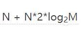
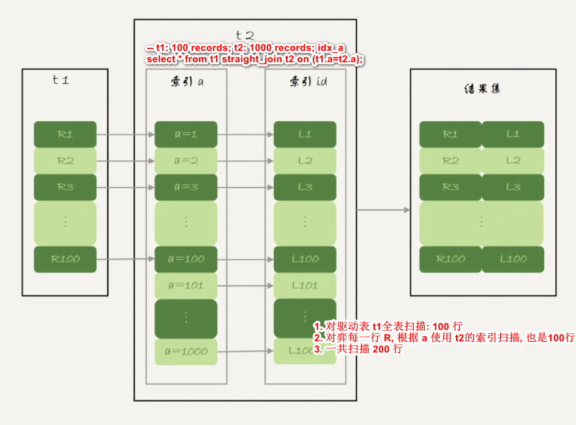
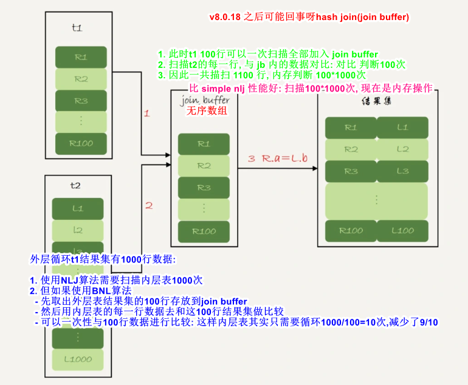
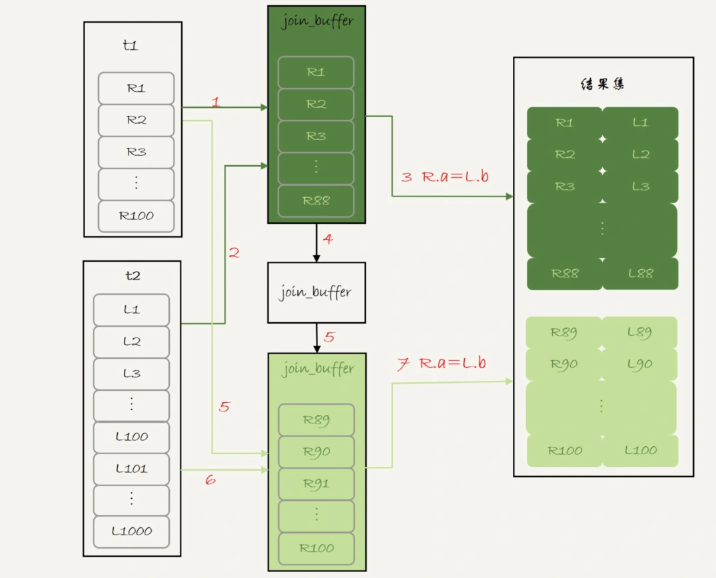
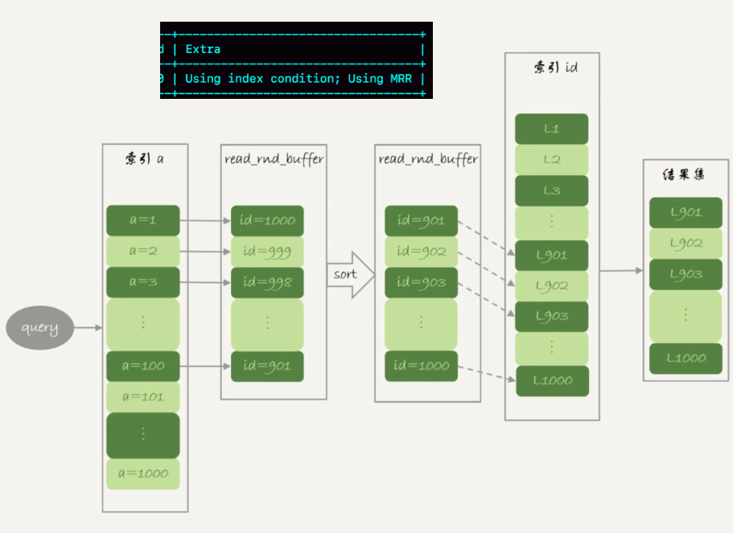
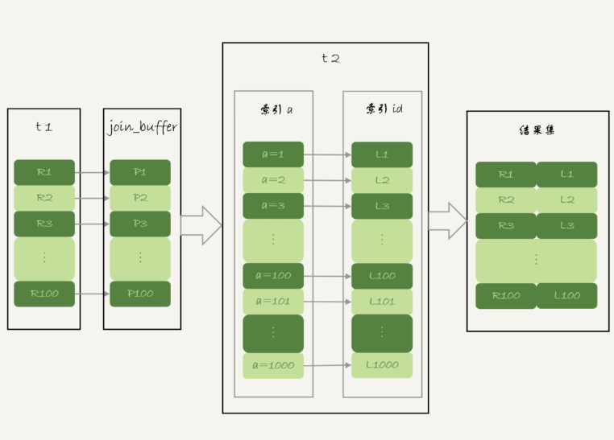

[toc]

## intros

1. join 的流程及现象

   - 流程:
     1. 左表选取一条数据, 与右表匹配, 满足条件的留下; 左表下一条匹配
     2. 多表 join 是 a join b 的结果在进行 join c
   - 索引下流程
     1. 如果可以命中索引, 就会先使用索引**过滤一下数据(连表|where 条件[会影响驱动表的选择])**`, 之后才会进行 join
     2. 如果没有则会先做 join 之后根据 where 对 join 之后的结果进行过滤
     3. 驱动表是走全表扫描, 而被驱动表是走树搜索

2. 驱动表的选择(cost 计算): 小表作为驱动表

   - 左表就一条记录, join 右表则是**顺序读**
   - 最终产生的 row 不会变化, 但是过程中时不一样的 cost: 极端的例子(驱动表 n 条, 被驱动表 1 条)
   - 优化器回去比较这两种的 cost: `scan a' cost[io+cpu] + a's rows[某个地方记录的近似值] * b's cost`
   - nlj 时间复杂度(被驱动表命中索引): N 是驱动表行数, M 是被驱动表行数
     
   - join 下驱动表的选择
     ```js
     如果是 Index Nested-Loop Join 算法: 应该选择小表做驱动表
     如果是 Block Nested-Loop Join 算法:
        在 join_buffer_size 足够大的时候, 是一样的
        在 join_buffer_size 不够大的时候（这种情况更常见）, 应该选择小表做驱动表
     ```
   - **在决定哪个表做驱动表的时候, 应该是两个表按照各自的条件过滤, 过滤完成之后, 计算参与 join 的各个字段的总数据量, 数据量小的那个表, 就是小表**

3. 固定驱动表(straight_join): 不要被优化改动

   ```sql
   -- t1: 100 records; t2: 1000 records; idx_a
   select * from t1 straight_join t2 on (t1.a=t2.a);           -- t1 is drived table
   select * from t2 straight_join t1 on (t1.a=t2.a);           -- t2 is drived table

   select * from t2 join t1 on (t1.a=t2.a);                    -- t1 is drived table
   select * from t1 join t2 on (t1.a=t2.a);                    -- t1 is drived table

   select * from t2 left join  t1 on (t1.a=t2.a);              -- t2 is drived table
   select * from t1 left join  t2 on (t1.a=t2.a);              -- t1 is drived table
   ```

4. left join

   - **left join 如果 where 条件中含有 table_b 的非空条件[除开 is null] 会被优化成笛卡尔积的 join, 否则按照 SQL 执行**
     1. 将 LEFT JOIN 优化为 JOIN(即笛卡尔积 JOIN)可能会带来一定的性能提升
     2. 在 nlj 中是不会产生临时表的(直接在内存中只用两个指针进行配对, 得到结果), 但是在 bnlj &smj 就会需要临时表存储数据: sort/group 引起的临时表不算此场景下
     3. left join 要没有 where 的时候全量保存驱动表: 处理的数据量就相对大一些
   - left join 的右表在 on 中可以过滤, 且 on 的执行要早于 where, 所以右表的条件尽量写在 on 中, 可以减少最终临时表的 row: 这个是在不能优化为 笛卡尔积的情况下
   - inner vs left

     1. 只是在对驱动表的数据选择上不同, inner 被驱动表无满足条件时不取, left 会保留{但是在 where 中还是可以过滤掉的}
     2. inner join b: 也是有可能出现多条数据的{1 对 n 下}

5. ~~join 算法~~

   - 嵌套循环连接: 对于左表的每一行, 都会扫描右表, 找到与左表行匹配的行. 这种方式适用于左表和右表中至少有一个表较小的情况, 但是如果右表非常大, 则会导致性能问题.
   - 排序合并连接: 对左表和右表分别进行排序, 然后进行连接操作. 这种方式适用于左表和右表都很大的情况, 但是排序操作可能会消耗很多时间和资源.
   - 哈希连接: 将左表和右表分别存储到哈希表中, 然后进行连接操作. 这种方式适用于左表和右表中至少有一个表较大的情况, 但是需要消耗较多的内存和磁盘空间

## NLJ: index Nested-Loop Join

```sql
-- t1: 100 records; t2: 1000 records; idx_a
select * from t1 straight_join t2 on (t1.a=t2.a);
```

1. 基本流程: 和嵌套子查询差不多+使用上被驱动表的索引

   - 从表 t1 中读入一行数据 R
   - 从数据行 R 中, 取出 a 字段到表 t2 里去查找；
   - 取出表 t2 中满足条件的行, 跟 R 组成一行, 作为结果集的一部分: **这一步一般是不需要临时表的(除非排序等操作)**
   - 重复执行步骤 1 到 3, 直到表 t1 的末尾循环结束.
   - ~~如果还有第三个参与 Join, 则再通过前两个表的 Join 结果集作为循环基础数据, 再一次通过循环查询条件到第三个表中查询数据, 如此往复~~: 是直接 join 而不是先得到前两个的结果在 join 第三个
     ```sql
     NLJ 就按照一行行数据来判断的话, 流程应该如下: t1 straight_join t2 straight_join t3 的执行顺序
     1. 调用innodb接口, 从t1中取一行数据, 数据返回到server端
     2. 调用innodb接口, 从t2中取满足条件的数据, 数据返回到server端
     3. 调用innodb接口, 从t3中取满足条件的数据, 数据返回到server端
     上面三步之后, 驱动表 t1的一条数据就处理完了, 接下来重复上述过程
     (如果采用BKA进行优化, 可以理解为不是一行行数据的提取, 而是一个范围内数据的提取[多个 join buffer])
     ```

   

2. feature

   - 小表驱动大表所建立的连接次数也远比大表驱动小表所建立的连接次数要小的多 + **被被驱动表上创建索引**
   - inner join mysql 会自动优化大小表的顺序

3. 在被驱动表没有索引的情况下, 叫`Simple Nested-Loop Join`, 会损失大量的性能(扫描行数太多): mysql 在这个场景下使用的是 BNL 解决
4. 可以打开 MRR 和 BKA 进行优化

## BNL(被驱动表没有索引-性能不是很好): Block Nested-Loop Join

1. 基本流程： 8.0.20 去掉了/加入了 hash join

   - 把表 t1 的数据读入线程内存 join_buffer 中, 由于我们这个语句中写的是 select \*, 因此是把整个表 t1 放入了内存
   - 扫描表 t2, 把表 t2 中的每一行取出来, 跟 join_buffer 中的数据做对比, 满足 join 条件的, 作为结果集的一部分返回

   

   - 此时驱动表无所谓: 扫描行数和内存判断此时都一样

2. join buffer(默认 256k) 放不下场景流程: **分段放**

   - 扫描表 t1, 顺序读取数据行放入 join_buffer 中, 放完第 88 行 join_buffer 满了, 继续第 2 步
   - 扫描表 t2, 把 t2 中的每一行取出来, 跟 join_buffer 中的数据做对比, 满足 join 条件的, 作为结果集的一部分返回
   - 清空 join_buffer
   - 继续扫描表 t1, 顺序读取最后的 12 行数据放入 join_buffer 中, 继续执行第 2 步

   

   - 驱动表 N(小好), 被驱动表 M: 扫描行数是 N+λ\*N\*M; 内存判断 N\*M 次`(消耗cpu)`
     1. k 段: λ\*N, 因此 join_buffer_size 大一些, 则 k 会小

3. feature

   - 多关联一个表, 就会多分配一个关联缓存(join_buffer_size): 如果在一个 SQL 中关联的表越多, 所占用的内存也就越大
   - join_buffer_size 参数不合理: 容易造成服务器内存溢出的情况, 影响数据库性能的稳定性
   - cons: **`很容易导致 IO 高, CPU 高, 内存溢出等情况`**

4. BNL 算法的性能问题: BNL + 被驱动表*大*的冷表

   - io: join_buffer 可能放不下所有的数据, 因此会对被驱动表多次扫描
   - cpu: join_buffer 是个无序数组, 因此会在内存中判断`N*M`次
   - 内存: join_buffer 会占用系统内存, 影响性能和稳定性
   - pool buffer(内存命中率):
     1. 内存淘汰会采用 innodb 优化后的 LRU(old+young): 从磁盘读入内存的数据会先放在 old 区, 1s 后该数据页没被访问则 LRU 的尾部了(不影响内存命中率)
     2. 使用 BNL 算法的 join 语句, 多次扫描一个冷表, 而且这个语句执行时间超过 1 秒, 就会在再次扫描冷表的时候, 把冷表的数据页移到 **LRU 链表头部**
     3. 此时是冷表的数据量小于整个 Buffer Pool 的 3/8: 能够完全放入 old 区域的情况
     4. 如果冷表的数据量很大: 业务正常访问的数据页, 没有机会进入 young 区域(在 old 区且 1s 内被访问到), 因为冷表数量太大, 不停的将 old 去所有数据淘汰
     5. 所以会导致 Buffer Pool 在这段时间内, **young 区域的数据页没有被合理地淘汰**
     6. 此时内存命中率(内存命中率要在 99% 以上)就会降低, 只能在后续的查询中慢慢恢复
   - **优化**: join_buffer_size | 通过对被驱动表加索引转换成 NLJ/BKA | 对驱动表查询变成字表后操作(过滤后数据量小) | 将数据选入带索引的临时表(过滤后数据量不大)后操作

     ```sql
     -- t2: 100 万, 没有 b 的索引
     -- 此 SQL 是低频, 创建索引不划算
     -- 此时会 BNL: 将t1(小-1000)加载如join buffer, 扫描 t2 表, 每一行与 jb 对比(t1.b<>t2.b则跳过; 否则判断 t2.b in [1, 2000])
     -- cpu: 100w *100=10亿次
     select * from t1 join t2 on (t1.b=t2.b) where t2.b>=1 and t2.b<=2000;

     ---------------- 优化 ----------------
     create temporary table temp_t(id int primary key, a int, b int, index(b))engine=innodb;
     insert into temp_t select * from t2 where b>=1 and b<=2000;
     select * from t1 join temp_t on (t1.b=temp_t.b);
     ```

## cost 计算

1. calculate a's cost between all-scan and index: `io+cpu`

   - 全表扫描的 cost: rows \* 读取一行的 cost + 顺序读
   - 走索引的 cost: **走索引的 cost 会默认认为回表** 索引, 扫描该索引的 cost + 索引过滤后的行数 \* 回表时读取一行的 cost + 随机读

2. table_a has index of idx_a and idx_b, how to choose index

   - idx_a's cost: 扫描 idx_a 的 cost + idx_a 过滤后的行数 \* 回表时读取一行的 cost
   - idx_b's cost: 扫描 idx_b 的 cost + idx_b 过滤后的行数 \* 回表时读取一行的 cost

## optimize

1. _在多表连接情况下(数据量很多), 且此时有小表时, 则可以考虑将小表直接加载到内存中进行逻辑操作_
   - 否则 join 小表会产生大量的数据
2. 先将数据过滤出来之后再去执行 join
3. nlj 性能没啥大问题, bnl 性能稍差
4. **bnl 下: 被驱动表是大表, 且是冷数据, 执行时影响 IO/cpu/内存(bp 内数据-内存命中率变低)**
5. `select * from t1 join t2 on(t1.a=t2.a) join t3 on (t2.b=t3.b) where t1.c>=X and t2.c>=Y and t3.c>=Z;` 的执行流程及索引优化
   - 第一步一定要先确定谁是小表: 通过 where 过滤后的参与 join 的字段和最小的
     1. t1 是驱动表: t1 join t2 join t3, (t1_idx_c_a, t2_idx_a_c_b, t3_idx_b_c)
     2. t3 是驱动表: t3 join t2 join t1, (t3_idx_c_a, t2_idx_a_c_b, t1_idx_b_c)
     3. t2 是驱动表: 此时需要判断 t1/t3 的大小确定驱动表

### MRR(Multi-Range Read)

```sql
-- idx_a
select * from t1 where a>=1 and a<=100;
```

1. 使用 idx_a 获取 pk, 得到主键之后进行会标(随机读)

   - 此时就可以使用 MRR 进行优化这里的随机读
   - 根据索引 a, 定位到满足条件的记录, 将 id 值放入 read_rnd_buffer 中
   - 将 read_rnd_buffer 中的 id 进行递增排序
   - 排序后的 id 数组, 依次到主键 id 索引中查记录(一次匹配出这一批), 并作为结果返回: 放满了就上两步分块执行

   

2. MRR 提升性能核心: **顺序性**, 不是~~顺序读~~

   - 通过 idx_xa 获取一批 Id, 对其排序后到主键树上查询, 一次可以匹配一批
   - 且可以通过递归/栈等对只需要的节点只读取一边: 但是如果非常多, 是不如扫描链表的
   - 比如还有可能用到数据聚集性等特性: **`保证每个存在结果的数据盘只会被扫描一遍`**

3. 使用 MRR: 默认不起用

   ```sql
   -- 优化器判断消耗时: 默认会更倾向于不使用 MRR
   -- 把 mrr_cost_based 设置为 off: 就是固定使用 MRR 了
   set optimizer_switch="mrr_cost_based=off"
   ```

4. 用了 order by 就不能用 MRR: 需要结果排序, 所以 mrr 的排序没有意义
5. 会使用内存排序: read_rnd_buffer_size

### BKA(Batched Key Access): NLJ + MRR

1. 流程

   - 将查询条件按照索引顺序进行排序, 生成一个批次(batch)
   - 根据批次中的第一个条件使用索引进行查找, 获取匹配的行
   - 对于批次中的后续条件, 根据前一次查找获取的行集合进行过滤, 直到所有条件都被处理完毕
   - 将最终的结果返回给客户端
   - -
   - 把表 t1 的数据取出来一部分 P(查询需要的字段), 先放到一个临时内存(join buffer)
   - 根据字段 a 进行排序
   - 依次到 idx_a 索引中查记录, 并作为结果返回: 放满了就上两步分块执行

   

2. 启用 bka: 默认不起用

   ```sql
   -- BKA 算法的优化要依赖于 MRR
   set optimizer_switch='mrr=on,mrr_cost_based=off,batched_key_access=on';

   extra: Using join buffer (Batched Key Access)
   ```

3. core

   - 尽可能地减少索引查找的次数: 通过批量访问的方式将多次单行查找合并成一次多行查找, **保证每个存在结果的数据盘只会被扫描一遍**

4. pros & cons

   - BKA 适用于多个等值查询条件的情况
   - BKA 可以显著减少磁盘 I/O 和 CPU 消耗, 提高查询性能
   - 范围查询、模糊查询等其他类型的查询, BKA 的效果可能不如传统的索引查找
   - BKA 还需要消耗一定的内存来存储中间结果, 因此在内存有限的情况下, BKA 的效果可能会受到限制

### hash join: 8.0.18 开始支持

1. sql

   ```sql
   -- t2: 100 万, 没有 b 的索引
   -- 此 SQL 是低频, 创建索引不划算
   -- 此时会 BNL: 将t1(小-1000)加载如join buffer, 扫描 t2 表, 每一行与 jb 对比(t1.b<>t2.b则跳过; 否则判断 t2.b in [1, 2000])
   -- cpu: 100w *100=10亿次
   select * from t1 join t2 on (t1.b=t2.b) where t2.b>=1 and t2.b<=2000;
   ```

2. 因为 join buffer 是无序数组, 所以需要判断 10 亿次, 如果 join buffer 是个 hash table, 则就会是 100w 次的 hash 查找: 性能会变好很多
   - 扫描 t1 的数据并放入 hash table[join buffer]
   - 扫描 t2 表的每一行, 根据数据的 b 在 jb-hash 内的查找, 得到结果集
   - `ALL + Using where; Using join buffer (hash join)`

## reference

1. [join - 简介](https://mp.weixin.qq.com/s/yAPPQFWJ9NDHw1ck4MDvvQ)
2. [join - 实现](https://time.geekbang.org/column/article/79700)
3. [join - 优化](https://time.geekbang.org/column/article/80147)
4. [join - 优化](https://mp.weixin.qq.com/s?__biz=MzIwNjg4MzY4NA==&mid=2247485569&idx=1&sn=d6bc6678078a6c004dfa6d105e6bbda2)
5. [join](https://github.com/Alice52/java-ocean/issues/149)
